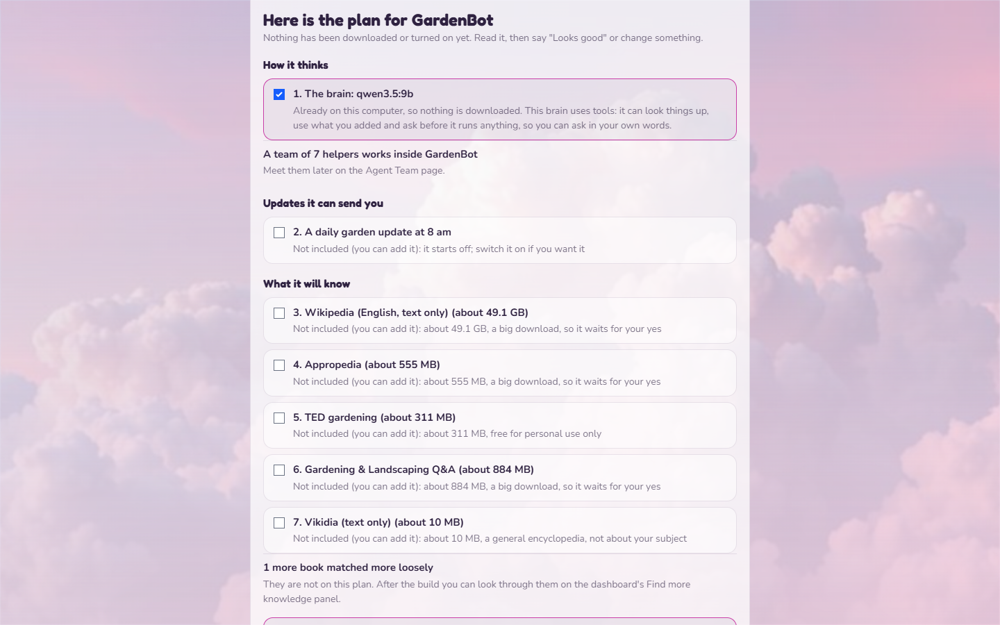
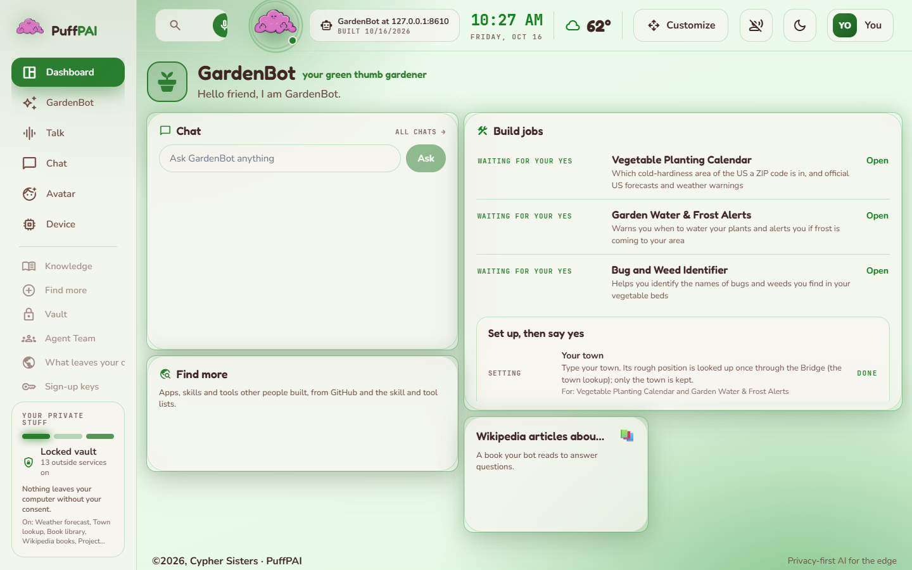
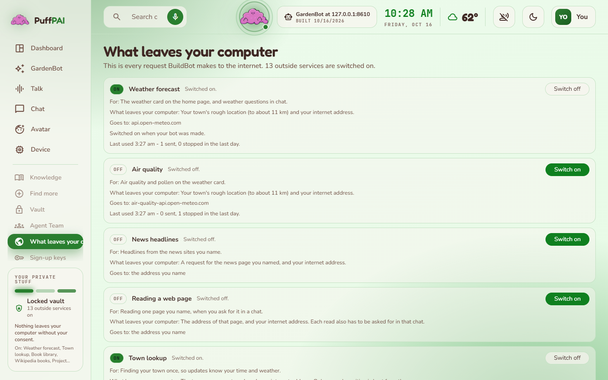
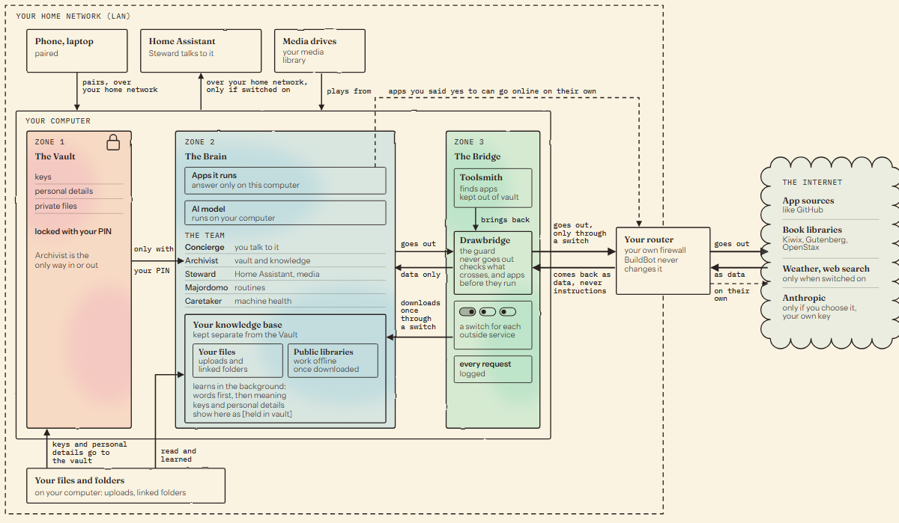
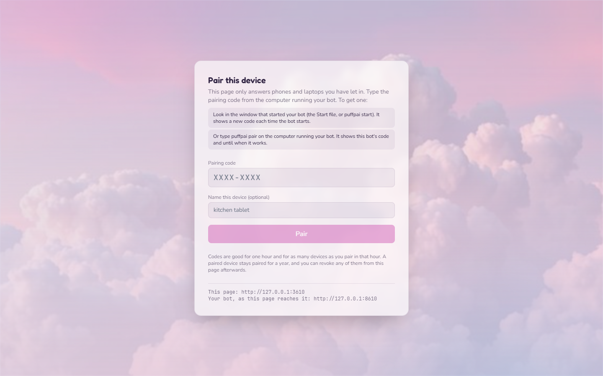
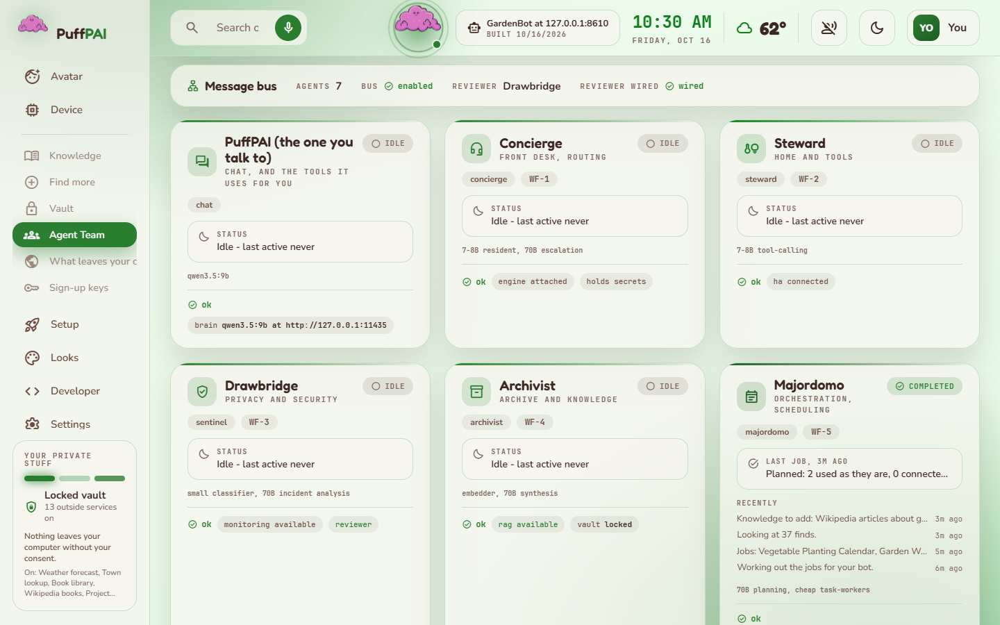
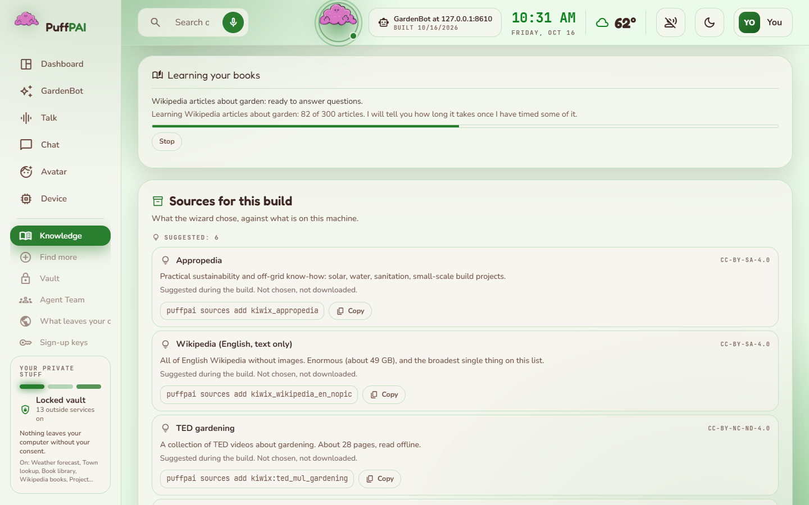
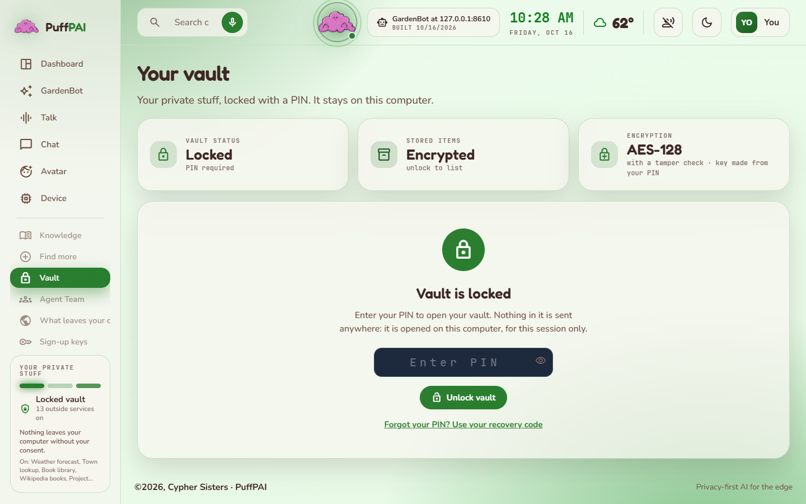

# PuffPAI BuildBot

BuildBot makes your own AI bot, on your own computer. You say what bot you
want, in your own words. BuildBot looks for books it can learn, live info it
can show you and services it can use, checks them, and shows you one plan.
You say yes, and it builds the bot. You can add more to it later.

The bot's brain runs on your computer. One page lists every outside service
your bot can use, what each one sends, and a switch for each.

**Questions?** The [FAQ](docs/FAQ.md) answers the common ones: phones, smart
home, firewalls, models (and Toolsmith's optional cloud model), adding your
own apps, code, programs and GitHub projects.
**Something broken, or an idea?** Tell us on the
[issue tracker](https://github.com/CypherSisters/PuffPAIBuildBot/issues)
([how to report](docs/ISSUES.md)). **How it fits together:** the
[architecture diagrams](docs/ARCHITECTURE.md#11-diagrams).

> **What computer you need**
>
> - A Windows 10 or 11 PC, a Linux PC, or a Mac with macOS 14 or newer (Apple
>   silicon is best; Intel works, slower). The Mac is new: an automatic check
>   installs BuildBot from nothing on an Apple silicon Mac and starts it, but
>   no one has used it on their own Mac yet. Reports are welcome.
> - Memory (RAM) decides which AI model your bot can run, and so how well it
>   can talk:
>   - **24 GB or more:** the biggest model (32 GB runs it comfortably). It
>     uses tools and handles requests with several steps, so you can ask in
>     your own words.
>   - **10 to 24 GB:** a 9B model, the one the wizard recommends. 16 GB runs
>     it comfortably. It uses tools well: it looks things up, adds what you
>     pick and uses it, so you can ask in your own words.
>   - **5 to 10 GB:** a 3B model, or a 7B from 8 GB. It does one job at a time
>     and does it well, so ask for one thing per message. It still uses tools,
>     more simply.
>   - **2 to 5 GB:** a 1B or 1.5B model, which only understands set phrases.
>   - **Under 2 GB:** no model fits, and the wizard says so instead of picking
>     one.
> - Free disk space: about 2 GB for BuildBot, plus 1 to 19 GB for the AI model
>   (the bigger your memory, the bigger the model), plus any knowledge you
>   choose to download.
> - A graphics card helps it answer faster. You don't need one.
> - Internet while you build your bot. Afterwards it can run without it.

## Install

**Windows, no typing:**

1. On this page, click the green **Code** button, then **Download ZIP**.
   Right-click the ZIP and pick **Extract All**.
2. In the extracted folder, double-click **install.cmd**. If Windows says
   "Windows protected your PC", click **More info**, then **Run anyway**.
3. It checks for Python, Ollama (it runs the AI model) and Node.js. If one
   is missing it asks before installing it. Then it builds your bot's web page,
   which takes a few minutes.
4. At the end it asks where you want to set up your bot: in your web browser,
   or right there in the window. Both ask the same questions.

After that, double-click **Start BuildBot.cmd** to start your bot and open it,
and **Stop BuildBot.cmd** to stop it. **Set up BuildBot.cmd** asks the setup
questions in a window instead of the web page. Once your bot has a name, you
also get a Start and Stop file with its name on them.

**Linux, or Windows from a terminal:**

```bash
git clone https://github.com/CypherSisters/PuffPAIBuildBot.git
cd PuffPAIBuildBot
bash install.sh                 # Linux; later ./start-bot.sh and ./stop-bot.sh
install.cmd                     # Windows Command Prompt, same as double-clicking
```

On Linux, `./run-setup.sh` asks the setup questions in the terminal.

**Mac:** download the ZIP and double-click it, open **Terminal**, type
`bash ` (with a space), drag **install.sh** from the folder into the window and
press Return. It asks once before downloading Python, Node.js and Ollama (no
password; each one is checked before it is used). Then double-click
**Start BuildBot.command** and **Stop BuildBot.command**. The first time, if
your Mac says it cannot check who made the file: right-click it, pick **Open**,
then **Open** (on macOS 15 or newer: **System Settings**, **Privacy &
Security**, **Open Anyway**). Details: [docs/INSTALL_MAC.md](docs/INSTALL_MAC.md).

**Starting from nothing.** You do not need Python, Node.js, Ollama, git or
Docker first. On Windows the installer offers each missing one through Windows'
own installer (winget); on a Mac or Linux it offers a pinned, checked download
into a tools folder of its own (Linux gets Ollama from Ollama's own script,
which asks for your password). The AI model itself is downloaded by the wizard,
after it asks. Docker is never required.

Both installers take options (`install.cmd -Help`, `bash install.sh --help`):
ports, where the private files go, a practice run that changes nothing, and no
questions for scripted installs. Nothing is installed or downloaded without a
yes from you or a flag that says so. Details:
[docs/INSTALL_WINDOWS.md](docs/INSTALL_WINDOWS.md),
[docs/INSTALL_LINUX.md](docs/INSTALL_LINUX.md).

If you like typing commands, `puffpai start` starts your bot and its web page
together and opens your browser, and `puffpai stop` stops them.

---

## The wizard

The wizard is the same in the browser and in a terminal (`puffpai setup`). Its
first screen, **Let's see what we're working with here**, shows what it found
on this computer (memory, processor, graphics card, free disk space, the
internet, Ollama and the models it already has) and the thinking model it
recommends for it: its size, one plain reason tied to those numbers, and the
other models that fit. Models too big for the computer are never offered.
Press Enter to use it, or **Change** to pick another.

Then it asks three questions:

1. **What kind of bot do you want?** In your own words: "a garden helper for
   my vegetable beds", "a bot that knows every dinosaur".
2. **What should we call it?** It offers a name made from your words.
   Press Enter to take it.
3. **How old are you?** Only the wizard's wording changes: under 13 gets
   shorter sentences. Only a rough age group is kept, never the number, and
   the finished bot never reads it. Press Enter to skip.

In the browser it also asks **Do you have a GitHub account?** Connect it and
your bot searches better and can use your own projects, or press **Skip**.

Then it shows **one plan**. Nothing has been downloaded or turned on yet.
Each line says what it is, how big it is, and which website it comes from.
Its parts, in order:

- **How it thinks.** The AI model it will use, and the team of helpers inside.
- **Updates it can send you.** For example a daily update at 8 am.
- **What it will know.** Books it can learn: offline libraries from Kiwix, a
  book of Wikipedia articles made from your words, Project Gutenberg,
  OpenStax textbooks.
- **Live info it can show you.** Live cards from free services that match
  your words, like plant sightings or the weather.
- **Websites and services it may use.** Weather, web search and the like.
- **Your private stuff.** The locked vault, and what happens to personal
  details you type.
- **Your gadgets.** Home Assistant, if you use it.
- **How it looks.** Colours picked from your words.

Something it found but did not switch on reads "Not included (you can add
it)", with its size and one plain reason. In the browser, under the plan it
asks **Where should BuildBot keep your knowledge and your files?** and shows
the free space there; **Change** picks another folder.

Press Enter for **Looks good** and it builds exactly that. Or pick **Change
something**, type an item's number, and switch it in or out. The same list
lets you pick a different brain, or keep your bot off the internet
completely.

After you say yes, it asks **Where should your vault live?** (on this
computer, a drive or folder you choose, or a vault you already have), and you
choose a **vault PIN**. The wizard shows a **recovery code** once. Write it
down: it is the only way back in if you forget the PIN.

It also asks **Who should do Toolsmith's installs?** **This computer (private,
slower)** keeps everything on your computer. **Anthropic (faster, your
choice)** puts Toolsmith, and only Toolsmith, on Anthropic's Claude with your
own key, which gets much better results (see
[Toolsmith works best on a frontier model](#toolsmith-works-best-on-a-frontier-model)).
Paste the key on that screen, never in chat. You can change your answer any
time in Settings.

Then it builds. While it builds, BuildBot looks for apps that do each part of
your goal; each one it picks waits for your yes under **Build jobs**. If one of
the apps that come with BuildBot fits your goal, that list offers to turn it
on, and your yes there does. The last
screen, **How to start it**, says what was added, what is still learning, what
is still missing, and your first pairing code. The first time you open the
dashboard, **Show me around the pages** walks you through it: where to add
tools and apps, how to unlock your vault, and how to give your bot your own
files and books to learn from.

Books learn in the background once your bot is running. A small book can
answer questions within a minute or two. You can chat while the rest learns.


*A build in nine steps. The two yes points are marked in coral: one for the plan, and one for each app before Toolsmith downloads it. [Full size](docs/images/architecture-how-a-build-happens.svg)*


*The plan for a garden bot, in the browser. The terminal shows the same plan.*

A real run, start to finish, is in
[docs/GETTING_STARTED.md](docs/GETTING_STARTED.md).

---

## Using your bot

Open it with **Start BuildBot.cmd** (or its own Start file, `./start-bot.sh`,
or `puffpai start`). The first time, the web page asks for a **pairing code**.
The window that started your bot shows it. Type it on your phone or laptop and
that device stays paired for a year. See [docs/PAIRING.md](docs/PAIRING.md).

The home page shows what to try, the live cards, what your bot knows and
what it is still learning. Ask "what can you do?" and it lists what it really
has. If you ask for something it has no way to do, it says it is **not
connected yet** instead of making something up. It may offer a daily update;
say yes or no.


*A new build's home page, a few minutes after setup. The apps it found wait for your yes.*

### Adding more later

- **In chat:** "add tomato diseases to you", "teach yourself about bird
  songs". Your bot looks in the lists saved on this computer first. It shows
  what it found and asks which to add. Before it looks online it asks "Look
  online too?" and shows the only words it would send.
- **The Add more page:** type what you want, press **Find**, tick what you
  want, then **Add these**.
- **In a terminal:** `puffpai add "tomato diseases"`. `puffpai add --list`
  shows what was added, and `puffpai add --take-out 2` takes one back out.

**Knowledge.** The Knowledge page has a **Find more knowledge** panel, and
**Add to library** takes a file of your own. In a terminal:
`puffpai sources search tomato diseases`, then `puffpai sources add <id>`.
`puffpai knowledge status` shows how far each book has learned.

**Looks.** The Looks page, or `puffpai looks find "outer space"`, then
`puffpai looks use 1`. `puffpai looks undo` goes back one step.

**Sign-up keys and web search.** Web search starts switched off. Switch it
on and your bot searches Wikipedia, with no key and no sign-up. For the whole
web, add a free key on the **Sign-up keys** page: Brave Search is tried first
(Brave asks for a payment card when you sign up), and Marginalia Search is the
backup that needs no card (personal use only). A key goes straight into your
vault. Your bot only searches when you ask it to.

### Apps

For each part of your goal, BuildBot looks for an app someone already built
(on GitHub, Codeberg and the skill and tool lists), picks the best fit and
shows it under **Build jobs**, waiting for your yes. Say yes and Toolsmith
downloads it, Drawbridge checks the code before anything runs, then Toolsmith
installs what it needs, starts it the way its README says (in Docker when it
ships its own containers) and checks that it really works. If no app fits, it
can make one from code that does the job. BuildBot starts the apps it runs so
they answer only on this computer; if one still answers other devices, its job
says so.

**Your first apps.** AlarmFlow, Calendar, FreshTable, FitFam and Trivia come
with BuildBot and start off. The Build jobs list offers the ones that fit your
goal, and your yes there turns them on. The Apps page lists all five under **Your first apps**,
each with **Turn on** or **Turn off**. Turning one off hides it and keeps its
saved data. A bot that already used one keeps it on.

### Toolsmith works best on a frontier model

Installing someone else's app is hard work: read its README, run its install
steps, fix what breaks, start it and check it. Toolsmith can do this with the
model on your computer, but a small local model often gets stuck and gives up
on an app. **Connect Toolsmith to a frontier model and you get much better
results:** far more apps installed and working, and much faster. Today that
means Anthropic's Claude (Opus 5.5 by default, or Sonnet 5.5).

To connect it:

1. Make a key (about 3 minutes): sign in to the
   [Anthropic Console](https://console.anthropic.com/settings/keys), add a
   payment method under Billing, then make a key on the API keys page and copy
   it.
2. In the wizard, on **Who should do Toolsmith's installs?**, pick
   **Anthropic (faster, your choice)** and paste the key there. Already set
   up? Open **Settings**, find **Toolsmith's model** and pick **Anthropic
   (faster, your choice)**.
3. The key goes straight into your vault. If the vault is locked, the page
   asks for your PIN right there.

What that means:

- **Only Toolsmith.** The brain and the other six agents always run on your
  computer.
- **What is sent.** When Toolsmith finds and installs apps, it sends Anthropic
  your goal and your bot's jobs, the public names, descriptions, stars,
  topics and language of the apps it found, each app's README, docs and file list, the
  start of its setup files, the commands it runs with their output, and what
  the app's pages show. Keys and personal details it spots are taken out
  first. It never sends your chats or vault. If you ask it to use a project of
  your own, it reads that folder like any app: its README and file list, the
  start of its setup files, and the commands it runs there with their output.
- **The key stays ready while it builds.** The vault locks itself after 5
  minutes without use. Toolsmith keeps its key in memory only, never on disk, while it
  works and for 1 hour after (Settings: 1 hour, 4 hours, or until you lock
  the vault), so a long build does not stop. Lock the vault to end it at once.
  If the key is not ready, the build waits and shows a PIN box to unlock.
- **Cost.** Anthropic bills your account for each use. Settings shows about
  how much Toolsmith has used, and your bot stops at 3000 requests a month. A
  test build that installed one app used about 25 cents.
- **No connection?** If Anthropic cannot be reached, Toolsmith uses the model
  on this computer for that app.

---

## Your privacy

- **The brain runs on this computer.** What you type stays here.
- **Toolsmith on Anthropic, only if you choose it.** What it sends is listed
  under [Toolsmith works best on a frontier model](#toolsmith-works-best-on-a-frontier-model).
  Your key lives in your vault.
- **Personal details.** Phone numbers, home addresses, birthdays, ID and card
  numbers are taken out of a chat before it is saved and put in the vault.
  While the vault is locked they go into a sealed inbox that only the vault
  can open; they are filed when you next unlock it. Saved chats themselves are
  not encrypted.
- **Keys.** Never paste a key into chat. Your bot refuses it before anything
  is saved or sent, and tells you to use the Sign-up keys page.
- **What leaves your computer.** One page lists every outside service your
  build has, what it sends and where. Each one has a switch. Switching one off
  is one tap. Switching one on needs a yes from a paired device, for that one
  switch, within ten minutes. The page also shows every request BuildBot made
  in the last day; the log is kept for 30 days and never records what you
  searched for or typed. In a terminal: `puffpai outside`,
  `puffpai outside off 12`, `puffpai outside log`.
- **Pairing is the gate.** Only paired devices can open your bot's web page.
  From a paired device you can add things and switch services on with no PIN.
  The PIN is for your vault.
- **One bot, one set of keys.** Every bot on one computer has its own API key
  and its own pairing code. A device paired with one bot is not paired with
  another.


*What leaves your computer, on the garden bot. Weather is on because the plan included it; the rest wait for your switch.*

---

## The three zones


*Where everything lives. The Vault opens only with your PIN, the Brain holds the team, the apps and your knowledge base, and the Bridge is the one way out, with a switch for each outside service. One honest exception: an app you said yes to can go online on its own. [Full size](docs/images/architecture-where-everything-lives.svg)*

BuildBot ships all three, like every PuffPAI build. They are contracts, not a
diagram.

- **Zone 1, the Vault.** An encrypted container for personal details, keys and
  private files, locked with your PIN. Nothing comes out without the PIN. Even
  the AI has to ask.
- **Zone 2, the Brain.** The AI model, five of the seven agents, Home
  Assistant, and what your bot knows: the books it learned and the files you
  gave it.
- **Zone 3, the Bridge.** The only zone that can reach outside, and responsible
  for the security and privacy of the whole build. The dashboard's **What leaves
  your computer** page lists every outside service this build has: what it is
  for, what leaves, where it goes, and a switch for each one that can be turned
  off. How many there are depends on the build. The page also shows every
  request BuildBot made in the last day. Two agents work here. Drawbridge
  checks everything the wizard or "add more" brings in before it is used.
  Toolsmith finds and installs the apps your bot uses, kept out of your vault,
  your bot's data and BuildBot's own parts. The Bridge
  works alongside the security gear you already run, and never touches it:
  it suggests a posture for your router or firewall and asks you.

---

## Build your own bot by hand

The wizard is the easy way. A **persona** is the same thing written by hand: a
local model pointed at a subject, books and apps as tools, and a page of its
own. HomeBot is the first persona we built, of many.

Everything you add is declarative JSON, validated before it loads:

- **Apps.** `apps/<id>/app.json`, checked by
  `app_registry.validate_manifest`. No field may name code to run.
- **Packs.** `packs/<id>/pack.json`, a list of apps, checked by
  `app_registry.validate_pack`.
- **Knowledge packs.** Offline ZIM archives; see
  [docs/KNOWLEDGE_PACKS.md](docs/KNOWLEDGE_PACKS.md).
- **Agents.** The seven below, the same in every build.
- **Avatar.** Puff, the PuffPAI cloud logo, is the default; bring your own
  `.glb` and the dashboard wears that instead. What an export has to contain:
  [docs/AVATARS.md](docs/AVATARS.md).

`puffpai persona new` writes a starting persona for you. The full walkthrough,
with a worked example that passes the validator:
**[docs/BUILD_A_PERSONA.md](docs/BUILD_A_PERSONA.md)**.

---

## What this does not do

Stated up front so nobody finds out the hard way.

- **One cloud option, for Toolsmith only.** The brain and six of the seven
  agents run on Ollama on this computer. Toolsmith can use Anthropic with your
  own key if you choose it; it starts on this computer.
- **Small local models struggle to install apps.** On the model on your
  computer, Toolsmith often fails to get an app running; Anthropic is what
  works well today. Big apps made of many services may not come up; Toolsmith
  says so and moves on to the next one.
- **No gadgets yet.** The wizard lists your gadgets (a smart telescope, a
  record player) and says "not connected yet". Home Assistant is the one hub it
  can connect to today.
- **No sandbox on Windows.** The Toolsmith's shell tool needs Linux and
  bubblewrap (see below). Apps Toolsmith installs after your yes run on your
  computer as they were built, like a program you install yourself.
- **No network census.** The wizard surveys the machine, not the wire: no LAN
  scan, no discovery of what else is on your network. Deliberately deferred.
- **No peripheral registry.** Cameras, microphones and USB devices are not
  part of the census, so the wizard cannot tell you what a box can hear or
  see.
- **Performance numbers are measured on one reference machine only.** The
  model list carries a benchmark solely for silicon we have actually benched;
  everything else reads "untested, reports welcome" and is never extrapolated.
- **Hardware matrix:** Windows x64 verified, Linux x86_64 verified, Jetson AGX
  Orin census verified. macOS 14 on Apple silicon installs and starts in an
  automatic check; no one has used it on their own Mac yet. Raspberry Pi
  untested. Reports welcome. The
  2 GB floor is enforced in code and tested with a synthetic census only.

---

## The agent team

The roster that ships in this repo is **seven agents**
(`src/puffpai/agents/registry.py`), each with a single clear role. No agent acts
silently: every state-changing action is visible and gated.

| Agent | Role |
|-------|------|
| **Concierge** | The conversation frontend, how you talk to your bot. |
| **Steward** | Home Assistant and media control. It uses your Home Assistant token and media key but does not keep them: they are kept in your vault, which is Archivist's, with a copy sealed by this computer's own key in BuildBot's settings folder, so lights and media still work while the vault is locked, after it moves to another folder, or while the drive it is on is unplugged. A token saved while the vault was locked, or before this version, stays in BuildBot's settings until the next time you open the vault, then moves in. |
| **Drawbridge** | The Bridge agent. Veto authority on any state-changing action; if Drawbridge says no, it doesn't happen. It also checks every book, live card and service before your bot uses it. (internal id `sentinel` in configs and logs) |
| **Archivist** | The sole gateway to the vault and the knowledge packs. All reads and writes go through it. |
| **Majordomo** | Proactive background work, the things that should happen without you asking. |
| **Caretaker** | Health checks that keep the system honest and running. |
| **Toolsmith** | The integration agent: finds an app for each part of your goal and, after your yes, installs it, starts it and checks it works. It also reads one web page when you have switched on "Reading a web page" and asked for it in chat. The only agent that may use a cloud model (Anthropic), and only if you choose it. It is never handed a key: its Anthropic key stays in your vault and is used for it. It works in the Bridge: a check on every command it runs keeps it out of your vault, your bot's data and BuildBot's own parts. That check is not a sandbox: an app's own install scripts still run as you, so say yes only to apps you trust (Docker apps stay inside Docker). |

Five live in the Brain. Drawbridge and Toolsmith work in the Bridge, the zone
that touches the outside.

**Toolsmith's own shell depends on the machine, and it says so.** On Linux
with `bubblewrap` installed it also gets a sandboxed shell against its own
workspace, with no network and no access to anything but that one directory.
On Windows, and on any box without `bwrap`, that tool is **not registered at
all** and the agent reports `shell: not on this machine (needs Linux +
bubblewrap)`. That shell never runs a command unsandboxed, and it is never
backed by Docker (Docker group membership is root-equivalent, which would turn
a bad web page into root). Installing an app is different: after your yes,
Toolsmith runs the app's own install and start steps in the app's folder, or in
Docker when the app ships its own containers.

---

## Knowledge

Your bot starts with only what its AI model already knows. There is no
bundled knowledge base and no scraped corpus. You grow its library during the
wizard, and afterwards from chat, the Add more page, the Knowledge page's
**Find more knowledge** panel, or `puffpai sources`. Books come from the Kiwix
library (offline [ZIM](https://wiki.openzim.org/wiki/OpenZIM) archives:
Wikipedia, Stack Exchange Q&A, TED talks, medical and survival references),
Wikipedia topic books made from your own words, Project Gutenberg and OpenStax.

Books live in a knowledge folder: `knowledge_packs` in your bot's data folder,
made for you, unless you point it somewhere else with
`puffpai setup --zim-dir`. Drop `.zim` files in it and BuildBot learns new
packs in the background, so chat works at once. It learns fast word search
first, so a 10 MB book can answer within about a minute, then learns meaning
search more slowly, at half the CPU, and pauses while someone is talking. A big pack like the full Wikipedia keeps
learning while you talk. `puffpai knowledge status` shows progress;
`puffpai knowledge sync` learns new packs now.

Everything you add is general knowledge, kept entirely separate from the
encrypted vault where your private data lives.
**[docs/KNOWLEDGE_PACKS.md](docs/KNOWLEDGE_PACKS.md)** is a starter list with
pointers to the public Kiwix library.

---

## What you need vs what's optional

Only two things are required. Everything else is a capability you switch on when
you want it, and each degrades cleanly when it is absent.

| | What | What it adds |
|---|---|---|
| **Required** | **Python 3.11+** | runs everything (the installer can get it) |
| **Required** | **[Ollama](https://ollama.com)** + a local instruct model | the assistant / all reasoning |
| Optional | **Node.js 22.12+** | the web page (the installer can get it and builds it); without it, `puffpai chat` or `puffpai ui` |
| Optional | **[Home Assistant](https://www.home-assistant.io)** + a long-lived token | smart-home control (the Steward) |
| Optional | **An [Anthropic](https://console.anthropic.com/settings/keys) key** | Toolsmith on a frontier model: much better app installs ([details](#toolsmith-works-best-on-a-frontier-model)) |
| Optional | **[Docker](https://www.docker.com)** | runs apps that ship their own containers |
| Optional | **Voice models** (Vosk STT, Piper TTS, wake-word) + a mic | local voice; `pip install -e ".[voice]"`, then check with `puffpai voice test` |

**Voice does not need Home Assistant.** The local pipeline is mic → wake word →
Vosk → LLM → Piper → speaker, entirely offline. Home Assistant only enters the
picture when a voice command should *act* on the smart home, or when you drive
your bot from an HA Voice satellite.

### Minimum requirements

The setup wizard's hardware census reads your **total** RAM and fits a model
against it: each catalog row's `min_ram_gb` is a floor on total system RAM
(`model_catalog.py::fit_menu`, `config/model_catalog.json`). The census
separately reports a model budget, total RAM minus
`min(max(total_ram_gb * 0.20, 2.0), 8.0)` GB reserved for the OS and everything
else. That budget is shown to you, and it is not what the fit is against
(`hardware_census.py:43-49,348`). The smallest catalog entry is
`llama3.2:1b` at **2 GB minimum RAM**, and that number is the real floor for
running BuildBot at all. Below it, the wizard picks no model and says:

> "This machine is below the floor of our smallest local model. Add memory,
> or point the wizard at a board with more RAM."

The plan shows "No brain picked" with that sentence, setup still finishes, and
the closing screen says your bot cannot answer yet, and why. Above the floor it never
falls back on a model your RAM rules out, including the configured default;
only a model you name yourself (with `--model`, or by typing its name) can be
bigger than that.

Higher RAM tiers reach larger, more capable models. The catalog currently
spans:

| Min RAM | Model | Download size |
|---|---|---|
| 2 GB | `llama3.2:1b` | 1 GB |
| 3 GB | `qwen2.5:1.5b-instruct` | 1 GB |
| 5 GB | `qwen2.5:3b-instruct` / `llama3.2:3b` | 2 GB |
| 8 GB | `qwen2.5:7b-instruct` | 5 GB |
| 10 GB | `qwen3.5:9b` | 7 GB |
| 24 GB | `qwen3:30b-a3b` | 19 GB |

**Which one the wizard picks.** Chat uses tools (it looks things up, adds what
you pick and uses it), so the brain must be able to call them. Where your
computer can run a model of 9B or more, the wizard recommends one: a 9B or
bigger model already installed if there is one, otherwise `qwen3.5:9b` (a 7 GB
download), never the 19 GB row unless it is already there. The one exception
is a board we have measured ourselves: on that exact board (today a Jetson AGX
Orin 64GB), with at least the model's recommended RAM and free disk for its
download plus 20%, the wizard recommends the model we measured there,
`qwen3:30b-a3b`, and says it is a 19 GB download. Any other computer keeps the
9B. Where no 9B model fits, it recommends the smallest model that still uses
tools (a tool model you already have wins, so there is nothing to download).
Only when no model that fits can use tools does it fall back to the most
capable one, and it says chat will answer without tools. A `--yes` run picks
the same way, except that it keeps the 9B on a measured board too, so nobody
watching means no 19 GB download. `--model` overrides all of it.

There is no enforced disk-space or CPU-architecture floor. Any CPU Ollama
itself supports works. Before offering to download a model onto a **local**
Ollama, the wizard compares the "Download size" above (plus 20% to unpack)
against the free space on the model store, and warns you if it won't fit. It
warns and does not refuse, because the size is an estimate and you may know
your disk better than it does.

---

## Quickstart

For people who type commands. The installer does all of this for you.

```bash
git clone https://github.com/CypherSisters/PuffPAIBuildBot.git
cd PuffPAIBuildBot
bash install.sh                   # or install.cmd on Windows; or just: pip install -e .
                                  # add ".[dev]" if you want to run the tests

puffpai setup         # the wizard: three questions, then one plan to say yes to
puffpai start         # start your bot and its web page, and open it
puffpai stop          # stop them
puffpai chat          # talk to your bot in the terminal instead
puffpai add "bird songs"          # add more to your bot
puffpai sources search bird songs # find more books
puffpai outside       # what leaves your computer, with a switch for each
puffpai keys          # sign-up keys (Brave and Marginalia search)
puffpai looks         # how the web page looks
puffpai routines      # daily updates and reminders
puffpai prove         # ask the running bot to prove what it can do
puffpai where         # which folders, ports and Ollama this copy uses
```

`puffpai start` runs the bot and its web page on this computer only
(127.0.0.1), with the web page's usage reports switched off, and prints the
pairing code. `--port` and `--dashboard-port` pick other ports. It stays in the
window; Ctrl+C or `puffpai stop` stops both.

`puffpai setup` writes your bot's settings to `config/puffpai_config.json` in its
data folder, and a record of the build beside it. Run it again any time;
`puffpai setup --yes` asks nothing and downloads only what the command line
names. `puffpai setup --help` lists every option.

**[docs/GETTING_STARTED.md](docs/GETTING_STARTED.md)** walks through all of it
with a real wizard run, and **[docs/TROUBLESHOOTING.md](docs/TROUBLESHOOTING.md)**
covers the common snags.

---

## What it looks like

Shot on a fresh garden bot built with this code, a few minutes after setup.
Nothing personal is in them.


*Every device has to be let in with a code from the computer running BuildBot.*


*The wizard's one plan. "Looks good" builds exactly this.*


*Home: chat, the apps waiting for your yes, the weather, and what it knows.*


*Every outside service, what it sends, and a switch.*


*Seven specialists and the message bus between them.*


*The library while its first book is still learning.*


*The vault stays locked until you type the PIN.*

---

## How this was built

We're two people, and we vibe coded the whole thing with AI coding tools
(Claude Code). It works, and we think it's awesome. The code is probably a hot
mess in places, and we'd love real coders and engineers to take a crack at it.
Good places to start are the known rough edges under [Status](#status) and the
[issue tracker](https://github.com/CypherSisters/PuffPAIBuildBot/issues);
[docs/ISSUES.md](docs/ISSUES.md) says how to report one.

Working on the code with an AI coding tool? Point it at [AGENTS.md](AGENTS.md); [llms.txt](llms.txt) has the map.

---

## Dashboard

The web page in [`dashboard/`](dashboard/) is a Next.js app served by the
computer that runs your bot. `puffpai start`, the Start files and
`./start-bot.sh` all run it for you. Every device that opens it is **paired
individually**, and the bot's API key is **held server-side** and attached by a
proxy, so the browser never receives it. It needs **Node 20+**
(`^20.19 || >=22.12`).

Its pages: Dashboard (home), Talk, Chat, Avatar, Device, Knowledge, Add more,
Vault, Smart Home, Agent Team, What leaves your computer, Sign-up keys, Setup
(the wizard), Looks, Developer, Settings, My Documents, Profile, Apps, and a page of its
own for your bot and for each live card.

If a pairing code has run out (they last an hour), `puffpai start` prints a
fresh one each time it starts, or type `puffpai pair` on the computer running
the bot. A paired device stays paired for a year and can be revoked from `/pair` at
any time. Full walkthrough: [docs/PAIRING.md](docs/PAIRING.md).

`puffpai apikey` prints the key this bot accepts. `puffpai apikey --new` gives
it a new one; other bots on this computer keep theirs. You only need it to run
the web page by hand (see [docs/GETTING_STARTED.md](docs/GETTING_STARTED.md)).
See [`dashboard/.env.example`](dashboard/.env.example) for every setting and
[`dashboard/README.md`](dashboard/README.md) for the details.

> **The login page is cosmetic.** It does not authenticate anyone. The real
> access control is pairing, and the API key carried by the server-side proxy.
> Run the dashboard only on a machine and network you trust; do not expose it
> to the public internet.

Without Node.js, use `puffpai chat`, or the desktop window `puffpai ui`, which
needs only Python and a display.

---

## Status

**The free early version you install yourself.** The wizard, add-more, app
installs by Toolsmith, your first apps, the outside page, sign-up keys, looks
and the agent team are implemented and tested; some rough edges remain. The full suite lives in `tests/`; run it with
`pip install -e ".[dev]" && py -m pytest` (`pytest` is in the `[dev]` extra,
not the base install). On PowerShell 5.1 run the two commands on separate
lines; `&&` is not a statement separator there.

Beyond the limits listed above, these are the rough edges we know about.

Known gaps:
- Matching is weakest for crafts words: "cross stitch" can also turn up a
  statistics Q&A site, and a search for tomato diseases can turn up an old
  book about horse diseases. Read what it found before you say yes.
- Personal-detail detection is English-first. Some bare names, ZIP codes and
  national phone numbers are missed.
- Key detection is a best guess. Very short keys and keys that look like words
  can slip past it, so paste keys only on the Sign-up keys page.
- Filters against instructions hidden in fetched text are pattern-based and
  English-first. Fetched text is treated as data and cannot act on its own, but
  reworded tricks can still colour an answer.
- A forgotten vault PIN is recovered with the recovery code: on the Vault
  page ("Forgot your PIN?") or with `puffpai vault recover`. Wrong codes are
  slowed down per running copy of the bot; a person at the computer's own
  terminal is not slowed, because they can already copy the vault's files.
- Spoken updates have not been heard on real speakers yet.
- `THIRD_PARTY_NOTICES.md`'s JavaScript table lists direct dependencies only;
  the transitive npm closure is not enumerated. The Python table is complete.
- Vendored fonts ship Latin subsets only; non-Latin scripts fall back to
  system fonts.

Star or watch to follow along. Found another rough edge? Report it on the
[issue tracker](https://github.com/CypherSisters/PuffPAIBuildBot/issues)
([how](docs/ISSUES.md)).

---

## The rest of the family

- **[CypherSisters/HomeBotBuild](https://github.com/CypherSisters/HomeBotBuild)**:
  HomeBot, the first persona, built with an earlier version of this wizard;
  the current one is being brought over.
- **[CypherSisters/HomeBotFounders](https://github.com/CypherSisters/HomeBotFounders)**:
  the Jetson Orin reference build.

---

## License

Apache License 2.0. See [LICENSE](LICENSE).

Built by Cypher Sisters.

Security reports: see [SECURITY.md](SECURITY.md).

### Credits

BuildBot depends on the open-source projects listed in
[THIRD_PARTY_NOTICES.md](THIRD_PARTY_NOTICES.md).

The web dashboard is derived from
[**admin-one-react-tailwind**](https://github.com/justboil/admin-one-react-tailwind)
by JustBoil (MIT): its layout shell, Tailwind theme and several base UI
components, modified. The template's MIT license ships verbatim at
[`dashboard/LICENSE`](dashboard/LICENSE).
