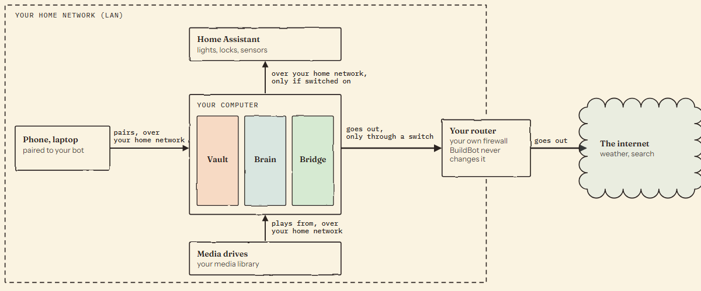
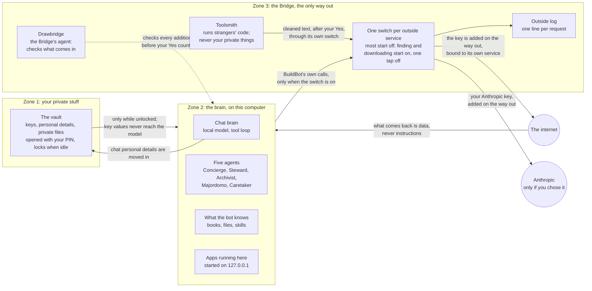
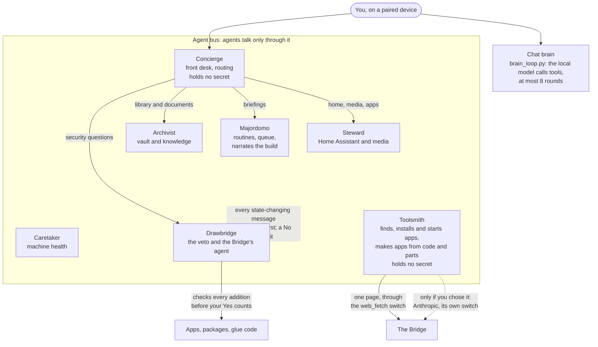
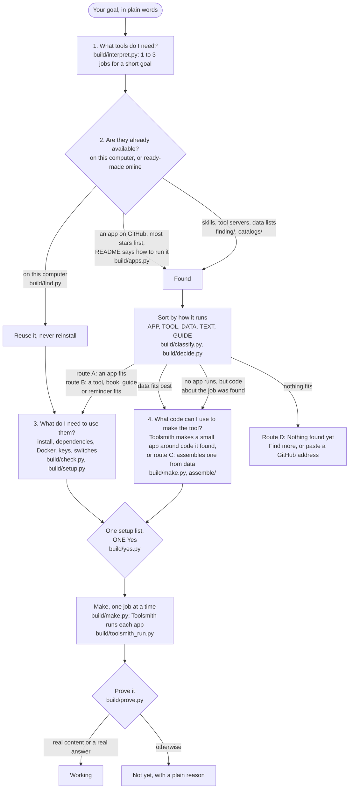
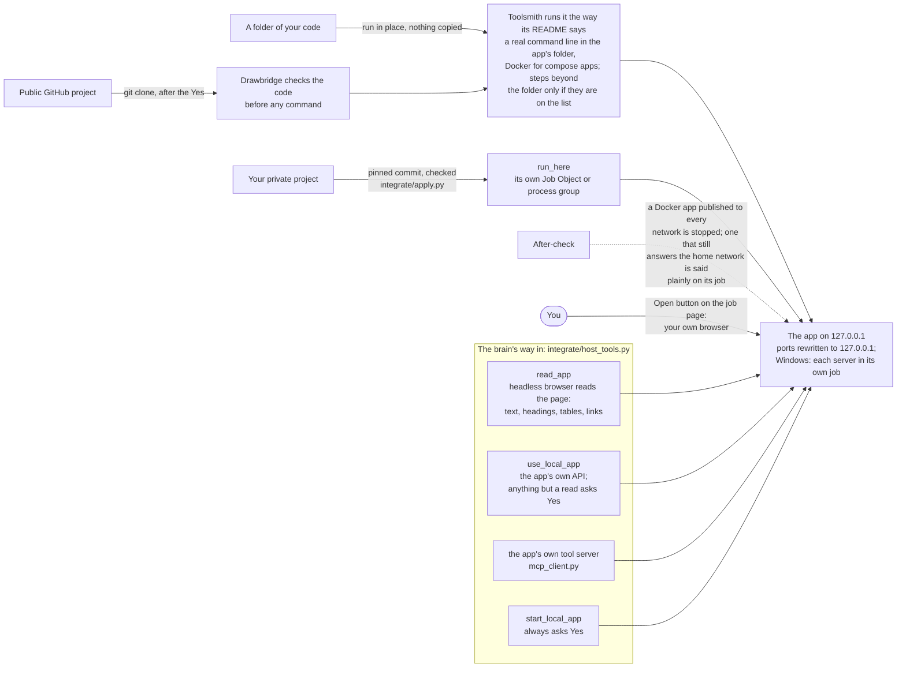
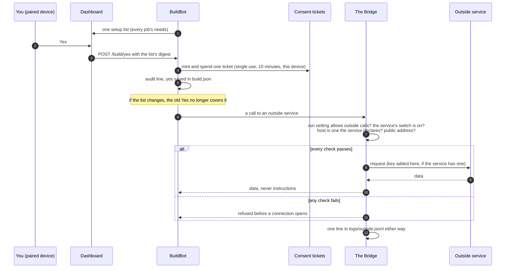

# BuildBot architecture

The deep reference behind [AGENTS.md](../AGENTS.md). Paths are relative to
`src/puffpai/` unless they start with `dashboard/`, `config/` or `tests/`.
Every module named here exists; when this page and the code disagree, the code
wins and this page is the bug.

Pictures first? [Section 11](#11-diagrams) has five diagrams (they render on
GitHub): the three zones, the seven agents, the build as four questions, how a
found app runs and how the brain reaches it, and the Yes and the Bridge. Common
questions are answered in [FAQ.md](FAQ.md); bugs and requests go to the issue
tracker ([ISSUES.md](ISSUES.md)).

## 1. Module map

| Area | Modules | Role |
|------|---------|------|
| Build pipeline | `build/schema.py`, `interpret.py`, `find.py`, `classify.py`, `decide.py`, `check.py`, `setup.py`, `yes.py`, `make.py`, `prove.py`, `pipeline.py`, `api.py`, `migrate.py`, `online.py`, `sources.py` | goal to jobs to one setup list to one Yes to working job pages |
| Finding | `finding/find.py`, `finding/install.py`, `finding/capabilities.py`, `finding/tools.py`, `catalogs/where_to_look.py`, `catalogs/searchers/*.py`, `catalogs/live.py`, `catalogs/api_seeds.py`, `catalogs/meaning.py`, `github_account.py` | where candidates come from, and the meaning matcher |
| Route A (apps as built) | `integrate/apply.py`, `integrate/fetch.py`, `integrate/classify.py`, `integrate/run_here.py`, `integrate/host_tools.py`, `webapps/` | fetch at a pinned commit, check, run on 127.0.0.1 |
| Route B (tools) | `mcp_client.py`, `skills.py`, `deps.py`, `routines.py`, `brain_commands.py` | tool servers, skills, declared programs, reminders |
| Route C (assemble) | `assemble/api.py`, `plan.py`, `shape.py`, `spec.py`, `accept.py`, `consent.py`, `report.py`, `seed_switch.py`, `toolsmith_loop.py`, `assemble/glue_runtime/`, `assemble/server/`, `assemble/scaffold/` | an app put together from data sources |
| Chat brain | `brain_loop.py`, `brain_tools.py`, `brain_tools_builtin.py`, `api_server.py` | the tool loop and its tool registry |
| Agents | `agents/registry.py`, `agents/bus.py`, `agents/base.py`, `agents/toolsmith.py`, `agents/majordomo.py`, `agents/sentinel_agent.py`, `drawbridge.py`, `agent_activity.py` | the seven agents, the veto, the team page lines |
| Security | `security/egress_doors.py`, `egress_ledger.py`, `consent_tickets.py`, `audit_log.py`, `vault.py`, `keys.py`, `secrets_provider.py`, `host_programs.py`, `chat_privacy.py`, `pasted_key_guard.py`, `skill_key_use.py`, `skill_programs.py`, `procflags.py` (top level) | the Bridge, consent, the vault, safe program starts |
| Owner pages data | `things.py`, `things_api.py`, `feeds.py`, `outside_services.py`, `outside_api.py`, `fix_api.py`, `plain_words.py` | one list of things, live cards, the outside page, fix cards |
| Wizard | `wizard/runner.py`, `wizard/packages/*/`, `wizard/needs_llm.py`, `zone_vault.py`, `zone_bridge.py`, `build_posture.py` | the setup flow that calls the build pipeline |
| Config and process | `config.py`, `cli.py`, `start_cli.py`, `fsutil.py` | settings, state folder, the command line |

## 2. Data flow: goal to job pages

```
owner goal (wizard: wizard/packages/assemble/skill.py -> build.pipeline.plan)
  |
  v
interpret   build/interpret.py   brain under an enum JSON schema, validate,
  |                              2 retries, then interpret.from_words
  v  jobs [Job]
find        build/find.py        github_account.candidates_for (first), build/apps.py
  |                              (GitHub by stars + app list, one brain rank), then for
  |                              jobs with no app: finding/find.search_jobs,
  |                              catalogs.live.discover_live, builtin:routine
  v  candidates [cand]
decide      build/decide.py      classify.classify + classify.not_usable,
  |                              similarities (catalogs/meaning.embed), fits, judge,
  |                              route_job: A > B > C > D, ingredients, view
  v
check       build/check.py       drawbridge.check_addition, apply.prepare_code_project,
  |                              address_problem; failed parts excluded, decide again
  v
setup       build/setup.py       rows_for -> merge -> apply_statuses
  |
  v  build.json saved (jobs: nothing_found / needs_setup / waiting_yes)
  |
POST /build/yes {sha}  build/api.py -> build/yes.give (ticket + audit) -> switch_sites
  |
  v  background queue (build/api.enqueue), one job at a time
pipeline.run_job
  make       build/make.py       A: _make_app -> _make_with_toolsmith -> build/toolsmith_run.py
  |                              (runs the app as its README says, the next app on
  |                              failure; a running app with the same ref or GitHub
  |                              owner/repo is reused); no app runs and job["code"]:
  |                              _make_from_code -> toolsmith_run MAKE task (a small app
  |                              from the library, kept with made_from); her private or already added
  |                              apps: apply.finish_prepared + run_here.start
  |                              B: mcp_client.add_server | deps.run_plan | routine | book
  |                              C: assemble.api.make_job_app
  prove      build/prove.py      sample ask through brain_loop.run with only this
  |                              job's tools; answer must fit the view (accept.prove for C)
  v
job status working | not_yet (+ reason)  ->  dashboard/app/dashboard/jobs/[id]/page.tsx
```

Find more (`pipeline.plan_more`) re-runs find and decide for one job or for new
words; if the list's digest changes the old Yes no longer covers it
(`yes.reset`), and only the changed jobs wait.

## 3. build.json (`<state>/build/build.json`, schema `build/v1`)

```json
{"schema": "build/v1", "goal": "...", "made_at": 0, "interpreted_by": "brain|brain+words|words|given",
 "jobs": [{"id": "pictures-of-earth", "name": "Pictures of Earth", "does": "...",
           "action": "show", "subject": ["earth"], "output": "pictures",
           "needs": ["none"], "ask": "Show me Earth today", "route": "C",
           "pick": {"ref": "...", "class": "DATA", "score": 0.61, "why": "..."},
           "ingredients": ["..."], "view": "gallery", "page": "job-pictures-of-earth",
           "status": "working", "reason": ""}],
 "setup": [{"id": "...", "kind": "key", "label": "...", "detail": "...",
            "job_ids": ["..."], "done": false}],
 "yes": {"given": true, "at": "...", "sha": "...", "by": "owner"},
 "dropped": [{"ref": "...", "name": "...", "why": "..."}],
 "parts": {"<ref>": {"ref": "...", "name": "...", "class": "APP", "...": "..."}}}
```

- Enums: `schema.ACTIONS`, `OUTPUTS`, `NEEDS`, `CLASSES`, `ROUTES`, `STATUSES`,
  `SETUP_KINDS`, `VIEW`, `MADE_VIEWS`. Owner words: `schema.WORDS`,
  `schema.how_words`.
- What a part keeps is fixed by `pipeline.PART_KEYS` (never skill text beyond
  32 KB for a TOOL, never raw finds, never file contents).
- Writes go through `schema.update_build` (one lock, atomic write).
- The Yes digest is `yes.sha(build)`: each job's route and parts plus every
  setup row. `yes.covers(build)` is true only for exactly that digest.

## 4. The Bridge, consent tickets and the audit trail

```
caller (feeds, assemble, toolsmith, keys, web search ...)
  -> egress_doors.egress_request(service_id, url)
       1. run posture (build record posture.run_egress): only "enumerated" may open
       2. the service's switch is on (default off; junk or unreadable config = off)
       3. URL host is one the service declares; public address only (resolved, pinned)
       4. requests with allow_redirects=False; each Location re-checked
       5. egress_ledger line: service, host, method, bytes, outcome, reason code
  -> EgressBlocked(user_message) on any refusal, before a socket opens
```

- Built-in services and per-app services: `app_door_id` (`app:<id>:feed`),
  `web_door_id` (`app:<id>:web`, browser apps, per-site switches),
  `build/sources.py` (`app:src_<hash>:feed`, one per outside host a data source
  calls). `GET /system/status` lists them all; the owner sees them on
  `dashboard/app/dashboard/outside/page.tsx` (`outside_api.py`).
- Turning a switch on: the server writes the sentence, mints a ticket
  (`consent_tickets.mint(action, target, sentence, device_id)`), the same paired
  device redeems it (`redeem`). Single use, 10 minutes, exact
  `(action, target, device)`, only the SHA-256 kept, in memory only. Actions in
  use include `outside_on`, `add_on`, `key_on`. Switching off needs no ticket.
- The build's one Yes is a ticket minted and spent at once for
  `("add_on", "build:<sha16>")`, plus one ticket per outside site the list shows
  (`yes.switch_sites`).
- Audit: `security/audit_log.py` writes `<state>/security_logs/audit.jsonl`
  (append-only, rotated). Ticket mint and redeem, installs, starts, stops and
  every Developer shell command are recorded. Outside traffic is the separate
  `<state>/logs/outside.jsonl` (no query string, no fragment, no credentials).
- Keys: `security/keys.py` holds curated rows (`config/catalog_seeds/keys.json`)
  with their hosts; the value is added on the way out
  (`egress_doors.keyed_first_hop`) and never returned to the caller.

## 5. run_here: outside projects on this computer

`integrate/run_here.py`. Plan types (`HOWS`): `node_server`, `python_server`,
`compose`, `web_build_static`, `node_cli`, `python_cli`, `library`, `assembled`.

1. `detect(src)` reads (never runs) `package.json`, `Procfile`,
   `pyproject.toml`, `requirements.txt`, compose files: install steps, start
   command, port, keys, interface (MCP, OpenAPI, CLI).
2. `shown_lines` is exactly what runs (argument lists, never a shell line);
   `plan_sha` is what the Yes covers, including `npm run` script text and
   `.npmrc` / `.yarnrc` contents.
3. `set_up` copies into `<state>/host_apps/<id>/app`; `npm ci --ignore-scripts`,
   venv + pip with `python -I`. Downloads only while the `code_download`
   service is on.
4. `start` binds 127.0.0.1 on a free port. A watcher checks every
   `WATCH_SECONDS` where each process listens; anything beyond loopback stops
   all of them (fail closed).

Containment per OS:

| OS | How processes are held |
|----|------------------------|
| Windows | each install step and start in its own Job Object, joined before the program runs, no breakaway, kill-on-close; `procflags.hidden()` so no console window opens |
| Linux, macOS | own session and process group; the group is stopped together |
| Docker (optional, only if already installed) | compose rendered with `docker compose config`, every port bound to 127.0.0.1, refused if it asks for host network, privileges, devices, the Docker socket or outside folders (`compose_problems`) |

Programs start by full path only (`security/host_programs.py`: node, npm's
`npm-cli.js`, git, docker, winget, apt-get, bwrap). A key the project asks for
reaches only its own process at start (`app_keys`), never an install step.
What the project does once running is not behind the Bridge; the Yes card says
so. This is containment, not a sandbox.

## 6. Toolsmith loop and glue rules

`assemble/toolsmith_loop.py`, called by route C when declared sources cannot do
the job alone (multi-step, auth headers, reshaping, wrapping a library).

- One JSON tool call per model turn: `read_part`, `web_fetch` (through the
  Bridge), `write_glue`, `run_glue`, `need_package`, `done`, `give_up`.
- Budget `BUDGET = {"steps": 8, "tries": 3, "minutes": 20}`; a run gets
  `RUN_SECONDS = 30`. Pass means a run returned at least one real row.
- `write_glue` writes only to `<state>/assemble/<id>/glue/<name>.py`, and only
  after Drawbridge's `glue` checklist passes (`assemble/glue_runtime/check.py`):
  one function per file; imports only `json`, `re`, `datetime`, `math`,
  `urllib.parse`, `puff_glue` and planned packages; no `eval`, `exec`,
  `compile`, `__import__`, `open`, `getattr`; no `_` attributes; no names with
  token, nonce or secret; restricted string formatting.
- `run_glue` starts `python -I -B glue_runtime/runner.py <request>` in a Job
  Object or process group. An audit hook refuses starting programs, `ctypes`,
  file writes outside its scratch folder, and every connection except
  127.0.0.1 on the gateway port. No vault key is ever in the process.
- Glue reaches outside data only via `puff_glue.fetch_source`, `fetch_json`,
  `fetch_text`, which ask the gateway; BuildBot fetches through the Bridge.
- Starting points: `assemble/glue_runtime/skeletons.py`. Packages named with
  `need_package` go on the app's plan and install only after its Yes
  (`deps.py`, each package checked by Drawbridge).

## 7. The assembled app contract

Spec `assembled_app/v1` (`assemble/spec.py`): `id`, `title`, `caps`,
`settings` (kinds `place, text, choice, key`), `sources` (kinds `http_json,
rss, m3u, glue, local_app`), `views` (`gallery, table, forecast, map, player,
chart, list, form, settings, links`), `actions`, `checks`. The brain only picks
from numbered lists (`assemble/shape.py` numbers the fields of one real
sample); `validate` checks; 2 retries; then a fixed fallback.

App server (`assemble/server/app.py`, standard library only), run by
`run_here` as plan type `assembled`, bound to 127.0.0.1:

| Route | Does |
|-------|------|
| `/`, scaffold files | prebuilt views from `assemble/scaffold/` |
| `/spec.json` | the spec, `media_proxy` set to `/media` |
| `/settings.json`, `POST /settings` | the owner's settings (a key shows only `{"set": bool}`) |
| `/openapi.json` | one `GET /api/<action>` per action, so the brain sees them as tools |
| `/api/<action>` | asks the gateway to run the action |
| `/media?url=` | pictures and stream pieces fetched by BuildBot through the Bridge, Range answered |

The server makes no outside call. It talks to the gateway
(`assemble/server/gateway.py`, 127.0.0.1 only, per-app token in its folder,
per-run tokens for glue, bodies at most 64 KB, port in
`<state>/assemble/gateway.json`). The backend side is
`assemble/server/host.py`: `prepare_start` refuses an app without its Yes or
with a glue file whose bytes are not the ones Drawbridge passed.

Proof (`assemble/accept.py`): each check's action must return rows that give
its view what it needs (pictures that load through the Bridge, a real position,
a stream that plays), and the check's ask through the chat loop must call that
action.

## 8. The chat brain tool loop

`brain_loop.run(messages, ctx, backend)`:

1. Send the chat and `brain_tools.available(ctx)` to the local model.
2. Tool calls: `brain_tools.call` each one; a `needs_yes` tool asks via
   `ctx["ask"]` (dashboard: an `ask` event, answered with `POST /chat/approve`,
   waits at most `ASK_SECONDS = 300`, silence is a no; terminal: `input()`).
   Results go back as `tool` messages.
3. Words: that is the answer.
4. At most `MAX_STEPS = 8`, then one call with no tools.

Tools are registered with `brain_tools.register(name, description, schema, fn,
needs_yes=...)` or come from providers (`register_provider`) for things that
come and go: MCP servers, added apps, assembled apps, live cards. The streaming
entry is `brain_loop.run_streaming`, used by `POST /v1/chat/completions` (the
dashboard chat and a thing's Try it / Ask, `_loop_openai_stream` in
`api_server.py`); `POST /chat/send` (Talk, the avatar) uses `brain_loop.run`.
Both run the loop for the owner only, so `read_app` and every other tool are
there. `POST /chat/stream` has no tool loop: no dashboard page calls it; it is
kept for scripts and answers from the shortcut chain and one plain model call.
`PUFFPAI_TOOL_LOOP=off` turns tools off.

## 9. Backend and dashboard routes

Backend: Flask app in `api_server.py`, port 8000 by default; blueprints from
`build/api.py`, `assemble/api.py`, `integrate/api.py`, `finding/api.py`,
`things_api.py`, `outside_api.py`, `keys_api.py`, `mcp_api.py`,
`developer_terminal.py` and others.

| Route | Module |
|-------|--------|
| `GET /build/status`, `GET /build/job/<id>`, `POST /build/yes`, `POST /build/check/<id>`, `POST /build/setup/<row>` | `build/api.py` |
| `GET /assemble/status`, `POST /assemble/run`, `GET /assemble/report`, `GET/POST /assemble/yes` | `assemble/api.py` |
| `GET /things`, `GET /things/<id>`, `POST /things/<id>/host`, `POST /things/install-missing` | `things_api.py` |
| `GET /outside`, `GET /outside/log`, `POST /outside/<id>/on`, `.../confirm`, `.../off` | `outside_api.py` |
| `POST /chat/send`, `POST /chat/stream`, `POST /chat/approve` | `api_server.py` |
| `GET /agents/status`, `GET /system/status` | `api_server.py` |
| `/developer/terminal/*` | `developer_terminal.py` |

Dashboard: Next.js in `dashboard/`, port 3003 by default.
`dashboard/middleware.ts` is the pairing gate and security headers;
`dashboard/app/api/backend/route.ts` is the proxy that holds the API key
server-side (the browser never gets it). Services per area live in
`dashboard/app/_lib/services/` (for example `buildService.ts`,
`assembleService.ts`). Main pages under `dashboard/app/dashboard/`: home
`page.tsx`, `jobs/[id]`, `things/[id]`, `agents`, `outside`, `keys`, `vault`,
`developer` (with `terminal`), `chat`, `add`, `knowledge`. The wizard is
`dashboard/app/onboarding/`.

## 10. Tests

`tests/`, run with `python -m pytest -q` (`pytest.ini` sets `pythonpath = src`).
Nothing in the default suite goes online; `tests/live/` holds opt-in live tests.

| Area | Tests |
|------|-------|
| Build truth tables, routes, matrix | `test_build_core.py`, `test_build_matrix.py`, `test_build_matrix_real.py` (`fixtures/build/real/`), `test_build_make.py`, `test_build_api.py`, `test_build_migrate.py`, `test_build_sec.py`, `test_build_skills_repos_and_sites.py`, `test_build_wire.py`; fakes in `fixtures/build/fakes.py` |
| Assemble | `test_assemble_core.py`, `test_assemble_glue.py`, `test_assemble_glue_network.py`, `test_assemble_server.py`, `test_assemble_consent.py`, `test_assemble_scaffold.py`, `test_assemble_scaffold.js` |
| Bridge and consent | `test_consent_tickets.py`, `test_egress_ledger.py`, `test_egress_credential_seam.py`, and the scan that every outbound call site is gated (`test_every_outbound_call_site_is_gated_or_marked` in `tests/test_dashboard_weather_egress_doors.py`) |
| Running outside code | `test_integrate_run_here.py`, `test_procflags.py`, `test_host_programs_full_paths.py` |
| Agents and chat | `test_toolsmith_agent.py`, `test_drawbridge_checks.py`, `test_agents.py`, `test_brain_loop.py`, `test_brain_loop_chat.py`, `test_mcp_client.py` |
| Docs and words | `test_docs_truth.py` (no em dashes, real commands, real images in `README.md` and `docs/*.md`), `test_plain_words.py`, `test_repo_hygiene_docs.py` |

## 11. Diagrams

Three overview pictures first, then the detailed developer view.


*Where everything lives. [Full size](images/architecture-where-everything-lives.svg)*


*How a build happens. [Full size](images/architecture-how-a-build-happens.svg)*


*The home build: your home network, your router and the one lane out. [Full size](images/architecture-home-build.svg)*

Phone-width versions sit beside each one in `docs/images/` (`-phone`).

Below them, five pictures of the same system, drawn from the code named under
each one. They are Mermaid, so GitHub draws them. If a picture and the code disagree, the
code wins and the picture is the bug.

### 11.1 The three zones and what may cross



Code: `security/vault.py`, `security/chat_privacy.py` (Zone 1);
`brain_loop.py`, Concierge, Steward, Archivist, Majordomo and Caretaker in
`agents/`, `knowledge/`, `integrate/run_here.py` (Zone 2);
`security/egress_doors.py`, `security/egress_ledger.py`, `outside_services.py`,
`drawbridge.py` and `agents/sentinel_agent.py` (Drawbridge), and
`agents/toolsmith.py` with `security/toolsmith_zone.py` (Toolsmith) (Zone 3). All seven
agents share one message bus (`agents/bus.py`, picture 11.2), so `agents/`
holds the agents of both zones: five work in Zone 2, and Drawbridge and
Toolsmith work in the Bridge. Book and source downloads go through `source_fetch.py`, a listed
Bridge exit with its own switches (`outside_services.py` `_OFF_SWITCHES`,
`SHELF_ROWS`: on as built, one tap off). Home services (Home Assistant, n8n,
Jellyfin, Calibre-Web) are checked as home addresses, and with the Bridge up
(`security/bridge_guard.py`) only a switched-on one is reached; Ollama on this
computer is always reached. Not behind the Bridge, by design: what an outside
program does once it runs here after its Yes (the Yes card says so).

Toolsmith sits in Zone 3 because it downloads and runs strangers' code and may
talk to a cloud model: `security/toolsmith_zone.py` keeps it out of the vault,
the state folder, the data and linked folders and the owner's personal
folders. It is the only agent that may use a cloud model (Anthropic), only
when the owner chose it with the consent sentence on screen
(`security/toolsmith_cloud.py`, the `toolsmith_cloud` switch); its text is
cleaned of key shapes and personal details first, and the key is used only
for api.anthropic.com. Every other agent and the chat brain stay local.

### 11.2 The seven agents and who calls what



Code: `agents/registry.py` (the roster, `build_team`), `agents/bus.py` (the
veto: with no reviewer, every state-changing message is refused),
`agents/concierge.py` (`_CATEGORY_TO_AGENT`), `security/secrets_provider.py`
(`_SCOPE_ALLOW`: which secrets each agent may hold), `drawbridge.py`
(`check_addition`). The chat brain is the local model, not an eighth agent; its
tools come from `brain_tools.py`. Toolsmith's own model is local unless the
owner chose Anthropic (`security/toolsmith_cloud.py`); its Anthropic key is
used by that module and never handed to the agent.

### 11.3 The build: four questions



Code: `build/pipeline.py` runs these steps for every goal. Majordomo narrates
them on the team page; Drawbridge checks every part in `build/check.py`. When
no app runs (none found, or every one gave up), `build/apps.py` has kept the
code it found (libraries, command line programs, the owner's own projects) as
`job["code"]`, and Toolsmith makes an app from it (`make._make_from_code`;
the app keeps `made_from`).

### 11.4 How a found app runs, and how the brain reaches it



Code: `build/toolsmith_run.py` (download, the command line, `start_server`,
`done`, the after-check, `toolsmith_apps.json`), `security/toolsmith_zone.py`
(where it may work), `build/make.py` (`toolsmith_app`: every public project
address and every folder of the owner's code goes to Toolsmith; a private
project and an app already added keep `integrate/run_here.py`),
`integrate/host_tools.py`, `mcp_client.py`. This is containment, not a
sandbox: what the app itself does once running is not behind the Bridge, and
its Yes card says so; an install script Toolsmith runs runs as the owner.

### 11.5 The Yes and the Bridge



Code: `build/yes.py` (`give`, `covers`, `switch_sites`),
`security/consent_tickets.py`, `security/egress_doors.py`,
`security/egress_ledger.py`, `outside_api.py` (turning a switch on asks for
its own Yes; turning one off does not).
